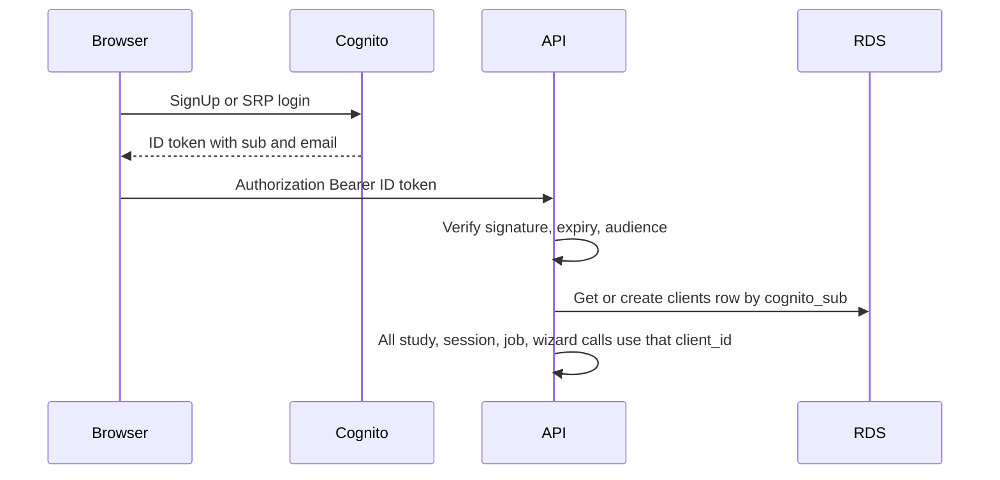

# Cognito login and tenant isolation

Production is the AWS deploy on the other machine (EC2, RDS, S3). Each Cognito account is one tenant. Cognito stores email and password. RDS keeps `[clients](backend/db/models.py)` (`id`, `email`, `cognito_sub`). Studies stay unique on `(client_id, slug)`.

`MARKET_SIM_AUTH=dev` stays the default so current tests and local runs keep using `local-dev`. The EC2 container turns on Cognito by setting `MARKET_SIM_AUTH=cognito` plus the pool settings below. No user pool is created from this repo.

## Login UI

Minimal pages only. No shell redesign.

- `[frontend/src/pages/LoginPage.tsx](frontend/src/pages/LoginPage.tsx)`, signup, and email-code confirm. Email, password, error text, link between the pages.
- Add `amazon-cognito-identity-js` and use SRP (`CognitoUser.authenticateUser`). The password never hits this API.
- `[frontend/src/router.tsx](frontend/src/router.tsx)`: those three routes sit outside the app. A `RequireAuth` gate wraps the existing shell. When auth mode is `dev`, the gate does nothing.
- `[frontend/src/api/client.ts](frontend/src/api/client.ts)`: send `Authorization: Bearer <id token>` on every fetch, including upload and download. On 401, clear the token and go to `/login`.
- A sign-out control in `[frontend/src/shell/AppShell.tsx](frontend/src/shell/AppShell.tsx)` clears the Cognito session.
- Pool id, client id, and region come from `GET /api/auth/config` so the SPA build on the other machine does not need `VITE_` secrets baked in. That response is public. It returns `{ "mode": "dev" }` or `{ "mode": "cognito", "region", "userPoolId", "clientId" }`.

## Token verification

New `[backend/api/auth.py](backend/api/auth.py)` and `[backend/api/routes/auth.py](backend/api/routes/auth.py)`.

- Verify the Cognito ID token with PyJWT against the pool JWKS (`RS256`, `exp`, issuer `https://cognito-idp.{region}.amazonaws.com/{poolId}`, `aud` = app client id, `token_use` = `id`).
- Cache the JWKS. Invalid or expired tokens return 401.
- `[backend/api/deps.py](backend/api/deps.py)` `get_current_client_id` reads that token and returns the client id. `resolve_client_id()` no longer falls through to `local-dev` when `MARKET_SIM_AUTH=cognito`.
- `[backend/api/middleware.py](backend/api/middleware.py)`: in `dev`, keep setting `current_client_id` to `local-dev`. In `cognito`, verify the bearer token and set `current_client_id` before the route runs. Leave `/api/health`, `/api/auth/config`, `/docs`, `/openapi.json`, and the static SPA unauthenticated.
- First valid token creates the RDS client row if `cognito_sub` is new, and stores the email from the token. Later requests reuse that row. Add `StudyRepository.get_or_create_client(sub, email)` in `[backend/db/repository.py](backend/db/repository.py)`.

## Bind every resource to that client

Sessions in `[backend/api/sessions.py](backend/api/sessions.py)` store `client_id` on `_Session`. `get`, `get_slug`, and `close` require the caller’s client id. `reload_study_for_slug(client_id, slug)` and `sync_study_display_meta` only touch that tenant’s sessions. Today reload matches slug alone, which is the cross-tenant bug in `[backend/api/routes/studies.py](backend/api/routes/studies.py)` (the design and HBU replace handlers).

`[backend/api/routes/sessions.py](backend/api/routes/sessions.py)` and the session lookups in `[backend/api/routes/scenarios.py](backend/api/routes/scenarios.py)` pass `get_current_client_id` into those methods. A session id from another tenant is 404.

Optimizer `[JobRecord](backend/api/routes/optimizer.py)` gets `client_id` at `POST /run`. `_persist_job` uses that id, not `resolve_client_id()` inside the worker. `get`, `cancel`, `save-scenario`, and `export` require the same client and the same slug. `[OptimizerJobRepository.get](backend/db/repository.py)` filters by `client_id`.

`_run_job` receives `client_id` as an argument. It constructs `ProjectCore(slug, client_id=...)` and `ScenarioStore(slug, client_id=...)`. `ThreadPoolExecutor` does not inherit the request context variable, so the worker must not call `resolve_client_id()`.

`[backend/data/scenario_store.py](backend/data/scenario_store.py)` takes an optional `client_id` and passes it to `scenarios_dir`. Request handlers pass the current client. Analytics helpers use `project.client_id`.

Wizard `[wizard_sessions](backend/api/routes/wizard.py)` store `client_id`. Design and HBU uploads require auth. A later HBU post from another tenant is 404.

## CORS

In `[backend/api/main.py](backend/api/main.py)`, drop the `"*"` origin. Development allows `http://localhost:5173` and `http://127.0.0.1:5173`. Any other origin comes only from `MARKET_SIM_CORS_ORIGINS` (comma-separated). When `APP_ENV` is not `development`, an empty list means same-origin only.

## Config on the other machine

Document in `[backend/.env.example](backend/.env.example)` and the AWS section of `[docs/ENVIRONMENTS.md](docs/ENVIRONMENTS.md)`:

- `MARKET_SIM_AUTH=cognito`
- `COGNITO_REGION`, `COGNITO_USER_POOL_ID`, `COGNITO_APP_CLIENT_ID`
- `MARKET_SIM_CORS_ORIGINS` set to the public site origin if the browser is not same-origin with the API

User pool, created once in that AWS account: email as the username, email verification on, public app client with no secret, SRP enabled. Lite or Essentials. Direct sign-in stays inside the 10,000 monthly-active-user free allowance.

## Tests

New backend test file. Keep the existing suite on `MARKET_SIM_AUTH=dev`.

- Verifier rejects a bad signature, a wrong audience, and an expired token (401).
- Two clients, one shared slug: list, read, edit, reload, export, optimizer job (status, cancel, export), and wizard HBU stay isolated. The other tenant gets 404, and a reload does not reinitialize the other tenant’s live session.

