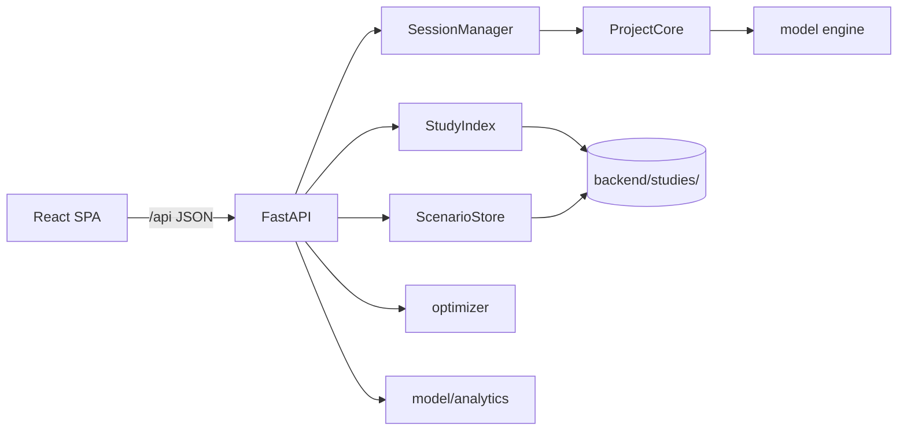

# Market Simulator — Roadmap

**Status:** Desktop→web parity largely shipped · open stubs below  
**Related docs:** [`UX_UI_SPEC.md`](UX_UI_SPEC.md) · [`CHART_ANALYSIS.md`](CHART_ANALYSIS.md) · [`OPTIMIZER_GUIDE.md`](OPTIMIZER_GUIDE.md) · [`MATHEMATICAL_MODEL.md`](MATHEMATICAL_MODEL.md) · [`decompiled/PORTING_NOTES.md`](decompiled/PORTING_NOTES.md)

Single roadmap + desktop→web requirements inventory. (Formerly `MIGRATION_PLAN.md`.)

---

## 1. Goal & principles

Ship a **React SPA + FastAPI** app over the existing Python simulation engine, with desktop V5.2 feature parity where it matters for analysts.

**Principles**

1. **Do not rewrite the math.** `model/` and `data/` stay authoritative; API is a thin adapter over `ProjectCore`.
2. **Contract-first.** Shapes in `UX_UI_SPEC.md` §9–§10; OpenAPI → TS types.
3. **Server holds heavy state.** Browser never receives the HBU matrix — only results/summaries.
4. **Parity via golden tests.** Chart Analysis and core metrics validated against desktop `.exe` exports (REQ-QA-01).
5. **Locked stack** (`UX_UI_SPEC.md` §13): single-user local, light mode, TanStack Table, Recharts + Plotly.js, job polling.

**Non-goals for v1:** auth/multi-tenant, dark mode, full keyboard grid nav, mobile, WebSockets, Pack/licensing, desktop undo stack.

---

## 2. Architecture

```
market_simulator/
├── backend/
│   ├── model/                 # Engine (unchanged math + analytics/)
│   ├── data/                  # Study/scenario I/O
│   ├── api/                   # FastAPI (sessions, studies, scenarios, wizard, optimizer, analytics)
│   ├── utils/excel_export.py  # Formatted Excel export
│   ├── studies/               # On-disk study JSON + HBU + scenarios
│   └── tests/
├── frontend/                  # Vite + React + TS SPA
└── decompiled/                # Model + Reports C# (gitignored) + PORTING_NOTES.md
```



**Runtime:** from `backend/`: `uvicorn api.main:app` + Vite `:5173` (dev) or SPA static via FastAPI (prod).

**Session model:** `SessionManager` (`sessionId → ProjectCore`, TTL/LRU); `serializers.py` for results/groups/totals/scenarios; optimizer jobs via thread pool + poll; analytics via `GET /api/studies/{slug}/analytics/{type}`.

**Sources of truth for porting**

| Source | Location |
|--------|----------|
| Desktop UI | `D:\All Simulator\simulatorcode\simulatorC\MarketSimulator` |
| Model DLL (decompiled) | `decompiled/MarketSimulator.Model/` |
| Reports DLL (decompiled) | `decompiled/MarketSimulator.Reports/` (`ChartForm`, `ExcelSheet`) |
| Porting notes | `decompiled/PORTING_NOTES.md` |

---

## 3. Feature catalog & REQ IDs

### A. Study management

| ID | Feature | Web status |
|----|---------|------------|
| S1 | Create study wizard | Done (subset of 9 desktop tabs) |
| S2 | Import from Excel | Done |
| S3 | Edit existing study | Done (REQ-S-01) |
| S4 | Switch active study | Done |
| S5 | Remove studies | Done (REQ-S-02) |
| S6 | Study registry | Done (`Studies` JSON index) |
| S7 | Pack client distribution | Out of scope (REQ-LIC-01) |

### B. Scenarios

| ID | Feature | Web status |
|----|---------|------------|
| SC1–SC4 | Save / overwrite / load / compare | Done |
| SC5 | Reorder | Done (REQ-SC-02) |
| SC6 | Remove | Done |
| SC7 | Import from Excel | Done (REQ-SC-01) |
| SC8 | Validation scenario flag | Stored |

### C. Simulation workspace

| ID | Feature | Web status |
|----|---------|------------|
| SIM1–SIM4 | Recalc, edit attrs/WD, include/exclude | Done |
| SIM5–SIM6 | Group include/exclude, bulk % edit | Done (REQ-EDIT-01) |
| SIM7–SIM8 | Product types, restore defaults | Done |
| SIM9 | Reversal Effect validation | Done (REQ-VAL-01) |
| SIM10–SIM11 | Clipboard / search | Partial / nice-to-have |

### D. Metrics

| ID | Metric | Web status |
|----|--------|------------|
| M1–M5 | Shares, pref, value, penetration, revenue | Done |
| M6 | Audit Share | Done — Runner grid + Compare (+ group rollups) |
| M7 | NOS / TDC / MM$ | Done (REQ-FIN-01) |
| M8 | Group rollups | Done (REQ-GRP-01/02) |

### E–F. Segmentation & groups

| ID | Feature | Web status |
|----|---------|------------|
| SEG1–SEG5 | Segment filter + scenario persist | Done single filter; **multi-AND = REQ-SEG-02** (open) |
| G1–G7 | Group panel, bulk edit, rollups | Done |

### G. Export & charts

| ID | Feature | Web status |
|----|---------|------------|
| E1 | Grid Excel export | Done — formatted (REQ-EXP-01) |
| E2 | Compare Excel | Partial |
| E3 | Print | Out of scope |
| E4 | Chart Analysis | Done — nine tabs + API (`REQ-AN-01`) |
| E5 | Color palette | Via Settings (REQ-UI-01) |

### H. Analytics (`ProjectCore` / Chart Analysis)

| ID | Analysis | Model API | Web status |
|----|----------|-----------|------------|
| A1 | Elasticity | `conditionalAttributeElasticityPer*` | ✅ sku/group/company_* |
| A2 | Price index / shares & revenues | `priceIndexAndRevenues` | ✅ |
| A3 | Cross-brand | `crossBrandInteractionPer*` | ✅ SKU + group |
| A4 | SoM vs SoP | `SoMvsSoP` | ✅ |
| A5 | Fair share | `FairShareOnSKUs` / `OnBrands` | ✅ SKU + brands |
| A6 | Incremental | `ex` / `cumIncrementalGainLoss` | ✅ exclusive + cumulative |
| — | Validation chart | Reports `ChartForm` | ✅ rebase + SKU/group |

REQ mapping: **REQ-AN-01** shell/page · **REQ-AN-02..06** price / cross-brand / elasticity / fair / incremental · SoM = A4 · **REQ-QA-01** golden ⏸️ open.

### I–K. Other

| ID | Feature | Web status |
|----|---------|------------|
| O2 | Brand Price Optimizer | Done (exceeds desktop) |
| U1 | Undo/redo | Out of scope |
| Engine flags | Metric visibility | Settings (REQ-UI-01) |

---

## 4. Open backlog

| Item | REQ | Notes |
|------|-----|-------|
| Multi-segment AND | REQ-SEG-02 | Engine supports `active_segments[]` + mask intersect; UI/API still single-filter. Target: stacked chips; `filters: [{assignment_key, member}, …]` on Runner / Optimizer / Analytics; scenario persist. |
| Golden parity tests | REQ-QA-01 | `tests/test_analytics_golden.py` skips until desktop `.exe` CSV/xlsx fixtures land (`tests/fixtures/golden/`). |
| Compare Excel polish | E2 | Partial vs Runner formatted export. |

Optional product work (tracked elsewhere): constrained commercial optimizer — see [`CONSTRAINED_OPTIMIZER_PROPOSAL.md`](CONSTRAINED_OPTIMIZER_PROPOSAL.md).

---

## 5. Testing & definition of done

| Layer | Approach |
|-------|----------|
| Engine | `tests/*` |
| API | FastAPI `TestClient` |
| Contract | OpenAPI → TS; fail on drift |
| Parity | Golden vs desktop Chart Analysis / Runner (REQ-QA-01) |
| Frontend | Vitest + Playwright smoke |

| Risk | Mitigation |
|------|------------|
| Analytics formula drift | Port from decompiled Model/Reports; golden tests |
| Contract drift | OpenAPI codegen |
| Optimizer blocks event loop | Thread executor + poll |
| Session memory | TTL + single-user |

A feature ships when: numbers match golden/desktop within tolerance; empty/loading/error/ready states exist; shared shell used; API covered by tests; REQ ID marked done in §3.

---

## 6. Completed phases (archive)

| Phase | Delivered |
|-------|-----------|
| **0** | FastAPI + React shell, read-only Runner |
| **1** | Runner edit/recalc, segments, groups, financials, validation, scenarios, bulk edit |
| **2** | Wizard, Compare, Study Manager / Simulator, basic Excel export |
| **3** | Brand Optimizer + Streamlit removed |
| **4b** | Analytics tabs (validation rebase, fair share brands, cum incremental, elasticity/cross-brand group variants) |
| **4c** | Settings live-apply, Compare audit/group metrics, formatted Excel, README |
